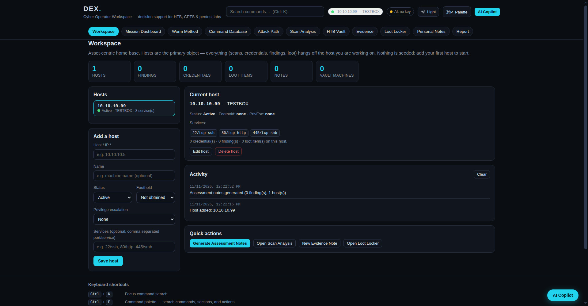
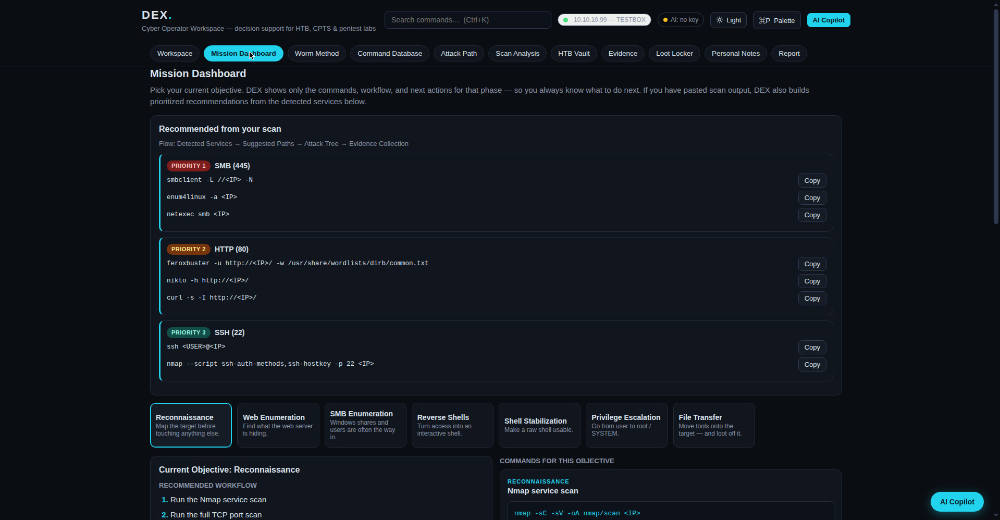
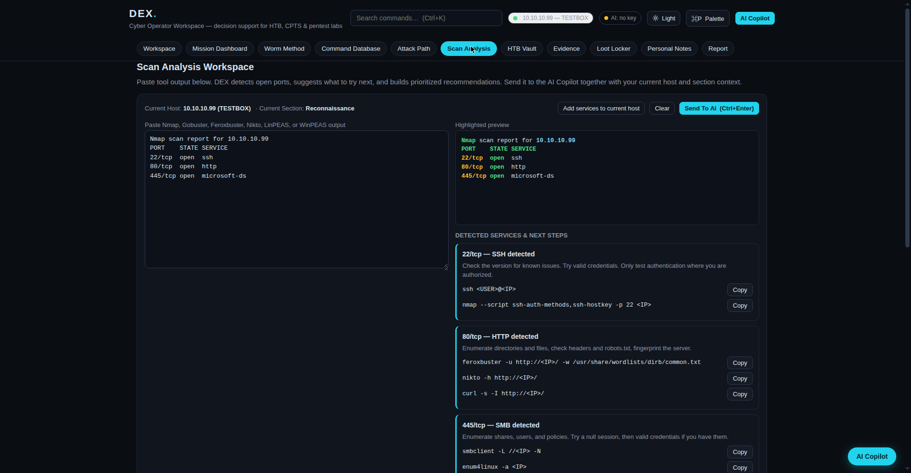
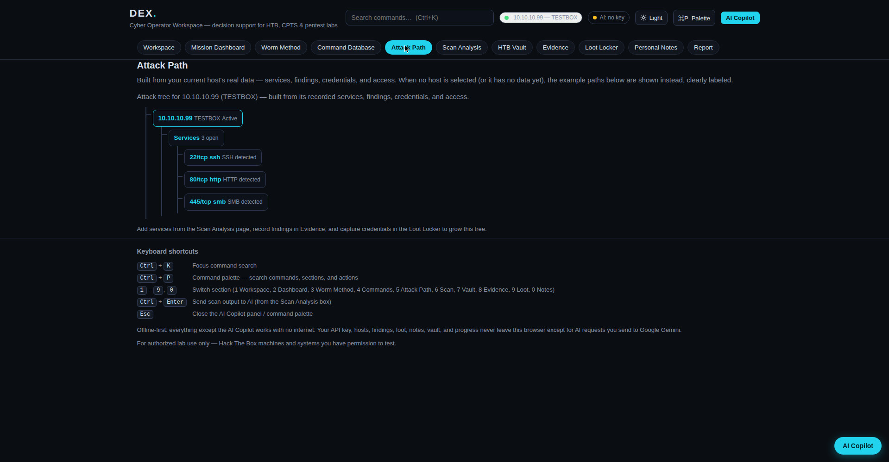
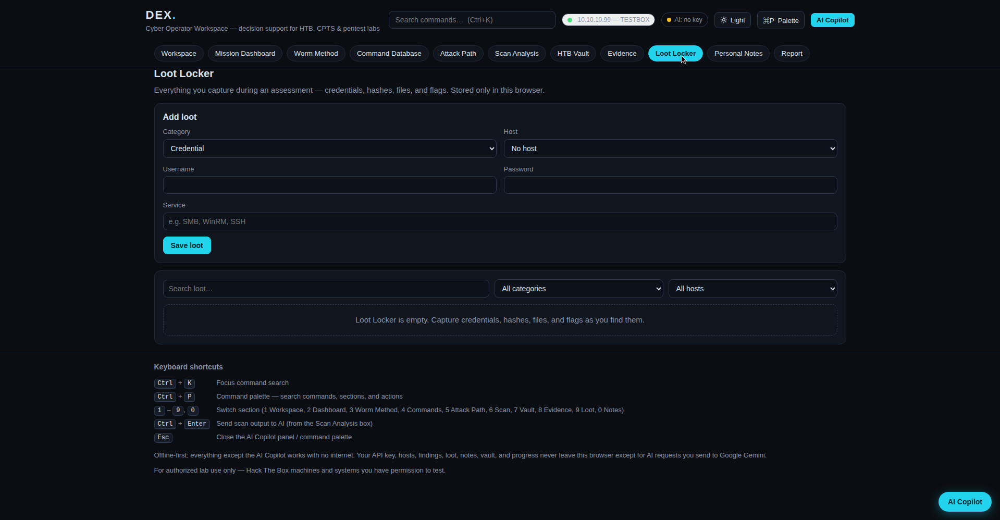
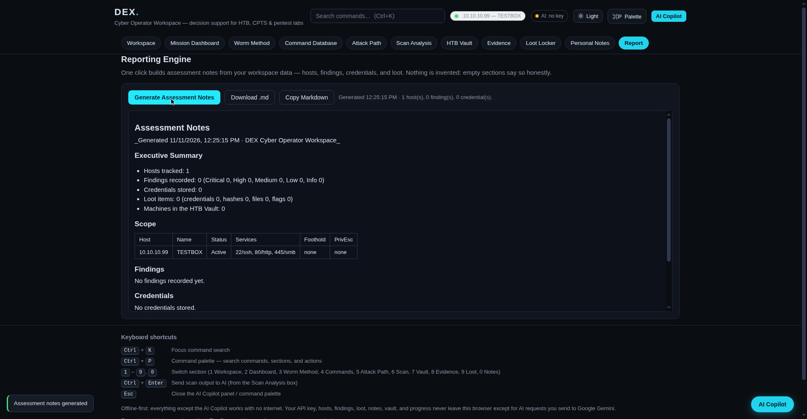
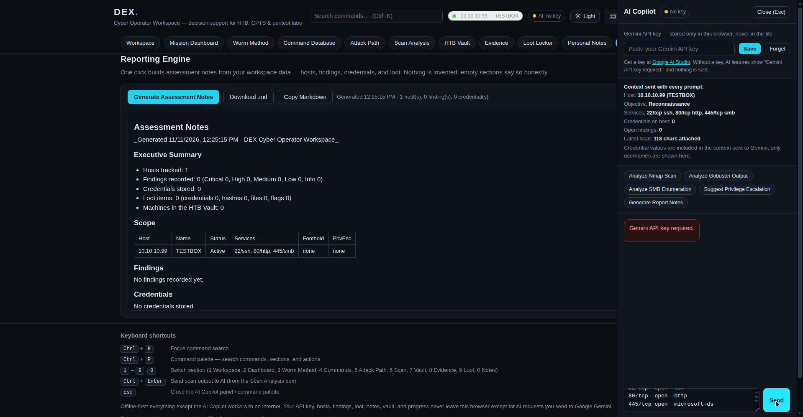

# DEX — Cyber Operator Workspace

A single-file, offline-first workspace for Hack The Box labs, CPTS study, and penetration testing practice. It helps you decide your next action during an assessment instead of digging through scattered notes.

## What it is

DEX is a decision-support tool, not a cheat sheet. You add hosts, paste scan output, and it tells you what to enumerate next. Everything revolves around the host — services, credentials, findings, evidence, loot, and notes all hang off the machine you're working on.

I built it as a learning project while studying cybersecurity at CTU and working through Hack The Box. It's a personal tool, not a commercial product.

## Features

- **Workspace (host dashboard)** — Add hosts with services, status, foothold, and privilege escalation state. A sidebar keeps every host one click away, and the selected host becomes the context for the whole workspace.
- **Mission Dashboard** — Pick an objective (Reconnaissance, Web Enumeration, SMB Enumeration, Reverse Shells, Shell Stabilization, Privilege Escalation, File Transfer) and get the recommended workflow, suggested next actions, and only the commands for that objective.
- **Scan Analysis** — Paste nmap output and DEX detects open ports (17 port rules) and builds prioritized recommendations: P1, P2, P3, with the commands to run.
- **Command Database** — 37 commands, each with a copy button, an explanation, and a use case. Search and filter by category.
- **Attack Path** — A per-host attack tree built from your real stored data. With no host selected, it shows labeled example paths.
- **Evidence** — Structured findings with title, host, severity, finding, evidence, and remediation. These feed the report generator.
- **Loot Locker** — Credentials, hashes, files, and flags, searchable and linked to hosts.
- **HTB Vault** — Notes on completed machines: box name, difficulty, platform, foothold, privilege escalation method, lessons learned.
- **Personal Notes** — Markdown notes with auto-save, search, and JSON export.
- **Report** — One click generates markdown assessment notes (Executive Summary, Scope, Findings, Credentials, Loot) with a preview, copy, and `.md` download.
- **AI Copilot** — A docked Gemini 2.5 Flash chat panel with quick actions (Analyze Nmap Scan, Analyze Gobuster Output, Analyze SMB Enumeration, Suggest Privilege Escalation, Generate Report Notes). It sends the current host, objective, latest scan, credentials, and open findings with every prompt, so the answers fit what you're actually doing.
- **Worm Method** — A five-phase workflow tracker (Enumerate, Identify Attack Surface, Gain Foothold, Escalate Privileges, Document Findings) with progress saved locally.
- **Keyboard shortcuts** — `Ctrl+P` command palette, `Ctrl/Cmd+K` search, number keys to switch sections, `Ctrl/Cmd+Enter` to send to AI.

## How to use

1. Open `index.html` in any browser. There is no install, no backend, and no build step.
2. Add a host in the Workspace tab, or paste nmap output in Scan Analysis and let DEX build the recommendations.
3. Work through the objectives, record findings and loot as you go, and generate the report when you're done.
4. For the AI Copilot, paste your own Gemini API key into the panel. The key is stored in your browser's localStorage only — it is never written into the file and never sent anywhere except to Google's Gemini API. Without a key, AI features show "Gemini API key required." and everything else still works offline.

## Tech notes

- One self-contained HTML file, vanilla JavaScript, no frameworks, no external dependencies.
- All data (hosts, findings, credentials, loot, notes, vault) is stored in the browser's localStorage. Nothing leaves your machine except AI requests when you choose to use them.
- Dark theme by default, with a light theme toggle. Mobile responsive.

## Honest notes

- This is a personal learning project I built with AI assistance. It is not a production tool and not a substitute for real assessment platforms.
- The commands are for Hack The Box lab machines and systems you have permission to test only.
- The AI Copilot can be wrong. Verify every command and finding yourself before acting on it.
